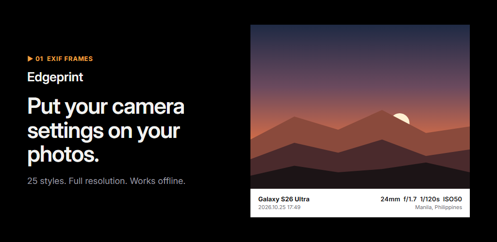
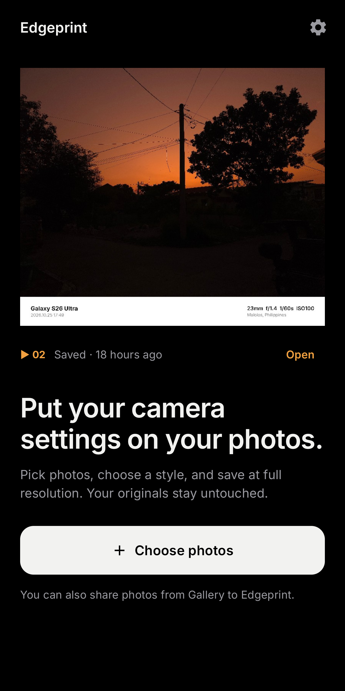
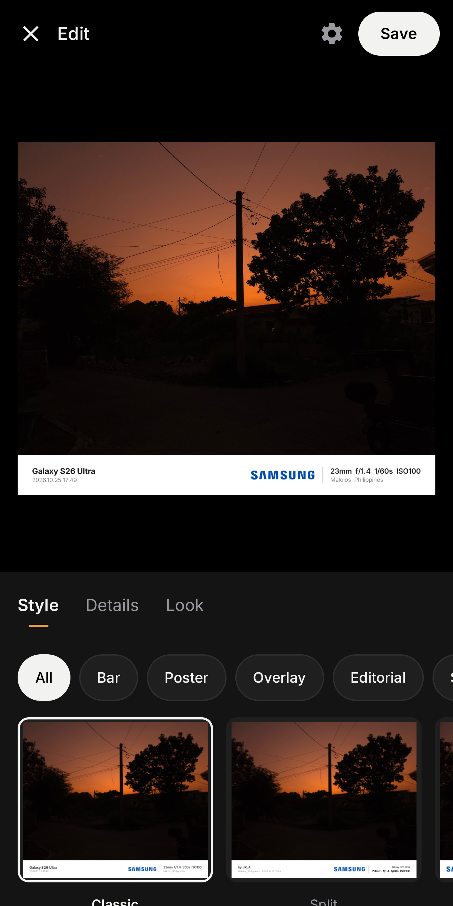
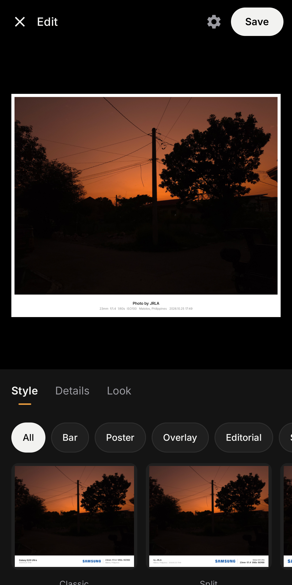
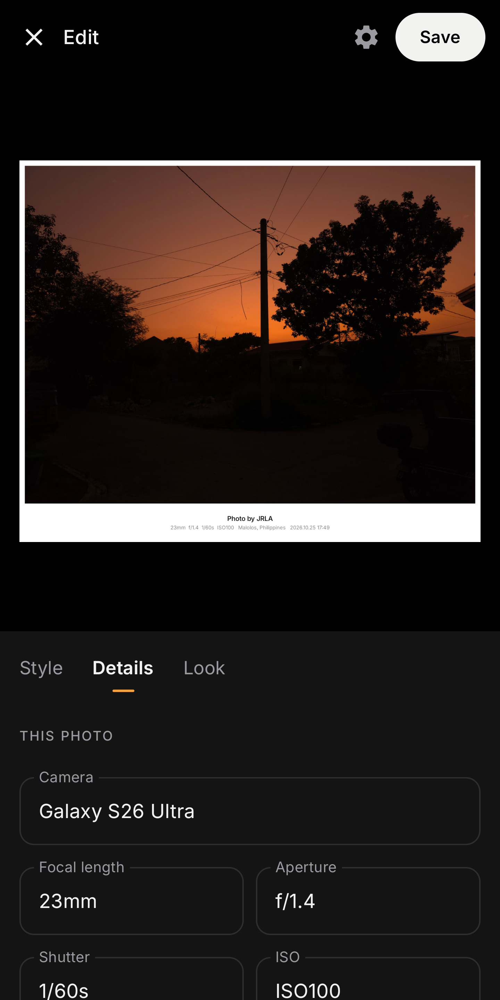
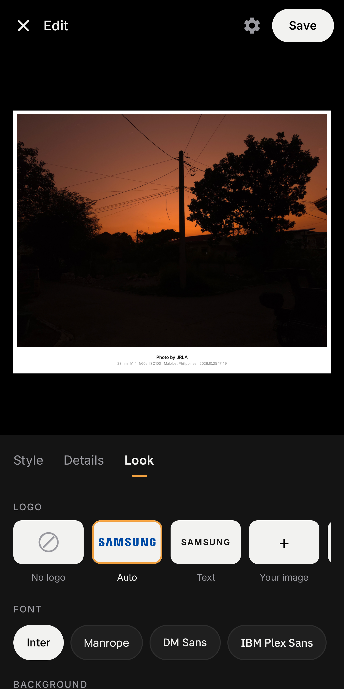

# Edgeprint



Edgeprint is an Android app that frames your photos with the camera, lens and exposure they were shot with, then saves them at full resolution. It reads the details already stored in each photo, works offline, and never changes your originals.

**[Download the latest APK](https://github.com/JanoAngulo/edgeprint/releases/latest)** · Android 10 or newer

<p>
  
  
  
  
  
</p>

## Features

- **25 styles in six families:** Bar, Frame, Poster, Overlay, Editorial and Special.
- **52 camera and phone brand logos**, picked automatically from the photo, or upload your own. Logos switch between black and white to suit the background.
- **10 bundled fonts**, 5 aspect ratios (Original, 1:1, 4:5, 9:16, 16:9), background colours and border size.
- **Every detail is editable:** camera, focal length, aperture, shutter, ISO, date, place, your name, a title or a quote.
- **Full-resolution export** up to 50 MP, or 4096 px / 2560 px, with adjustable JPEG quality. Camera metadata is copied to the saved file.
- **Batch editing** of up to 50 photos, and sharing straight from Gallery.
- **Responsive layout** for phones, tablets and landscape, including large text sizes.

## Privacy

Edgeprint doesn't request internet access, so it can't upload anything. There are no accounts, ads or analytics. Place names come from Android's built-in geocoder, and GPS can be stripped from saved photos with **Keep GPS in saved files** in Settings. See the full [privacy policy](store/privacy-policy.html).

## Installing the APK

1. Download `Edgeprint-1.0.apk` from [Releases](https://github.com/JanoAngulo/edgeprint/releases/latest) on your phone.
2. Open it and allow your browser or file manager to install apps when Android asks.
3. If Google Play Protect warns that it doesn't recognise the app, tap **More details → Install anyway**. This is normal for apps installed outside the Play Store.

## Building from source

Requirements: JDK 17 and the Android SDK with platform 36.

```bash
./gradlew :app:assembleDebug        # debug APK in app/build/outputs/apk/debug/
./gradlew :app:testDebugUnitTest    # unit tests
```

Release builds need a signing key. Copy `keystore.properties.example` to `keystore.properties`, point it at your own keystore, then run `./gradlew :app:assembleRelease` or `:app:bundleRelease`.

## Project layout

```
app/src/main/java/com/jrla/exifoneline/
  io/       EXIF reading, export, settings storage
  model/    photo info, styles and text
  render/   template drawing, fonts and brand logos
  ui/       Jetpack Compose screens
app/src/main/assets/   fonts (OFL) and brand logos
store/                 listing copy, privacy policy, graphics, screenshots, showcase PDF
logo-sources/          vector sources for logos added by hand
```

Built with Kotlin, Jetpack Compose and Material 3.

## Credits

Design and development by [John Russel L. Angulo](https://jrla1219.web.app).

Fonts are bundled under the SIL Open Font License; their licence files are in `app/src/main/assets/fonts/`. Camera and phone brand names and logos are trademarks of their respective owners and are used only to identify the camera a photo was taken with.
